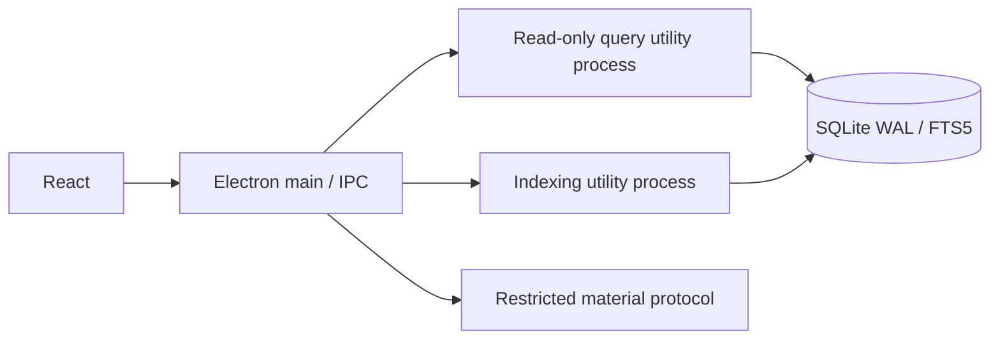

# 技术架构 / Architecture

React 界面通过受限 preload IPC 调用 Electron 主进程。主进程负责窗口、文件选择、路径校验、本地预览协议及剪贴板；同步 SQLite 与排序在独立查询进程执行。独立索引进程是数据库唯一写入方。

## 检索

文本经 NFKC、大小写及排版空白归一化，保留 UTF-16 原文映射。三字以上词使用 trigram FTS，短词使用子串匹配；多个关键词为 AND，完整短语优先，其次按最短覆盖区间，再按来源与页面排序。

候选用迭代器读取；大小为 offset+limit 的最大堆保留所需候选，完整遍历计算总数。关键词覆盖区间使用单调队列。单个查询连接缓存最后一组候选；SQLite data_version 和本连接 total_changes 共同使缓存失效。分页扩大范围时重新扫描，绝不截断总结果数。

主进程保留一个执行中的搜索和最新一个待执行搜索；被替换的等待请求返回 SEARCH_SUPERSEDED。界面请求序号防止过期结果覆盖；切换资料库使用额外的代际检查。数据库查询使用 WAL 读取快照。

## 处理与存储

先提取全部原生文字，再由最多三个 OCR worker 识别。原文件内容哈希用于去重与不可变快照；每页立即提交，暂停及退出后恢复。OCR 原生文字合并保留原文字层。索引表结构与 1.0.1 一致。

状态事件不包含全量文件列表。文件管理每页 100 条，查询侧筛选；预览只读取当前内容和相邻内容。PDF 展示与 OCR 分开：前者在 renderer，后者在索引进程。

应用缓存中的已失去引用、符合 SHA-256 命名规则的内容才可删除。清理只在索引空闲时运行，不跟随目录链接，保留未知文件及所有当前引用；失败后下次再试。

## IPC

- getState / onState：资料库、分类统计、文件夹、处理进度和版本。
- listDocuments：文件名/状态筛选，offset/limit 分页。
- search：关键词、类型、目录、offset/limit；返回完整总数和本页结果。
- preview：文档 ID、内容单元 ID、查询文字；验证内容归属。
- copyCitation：由主进程核对当前单元，复制最多 500 字符片段及相对路径、位置。
- storageInfo：软件版本、数据位置、索引与缓存字节数。

这些为应用内部接口，不是公共网络 API。进程退出会拒绝等待请求；下次明确操作才重启，后台监听不会无限重启失败进程。
